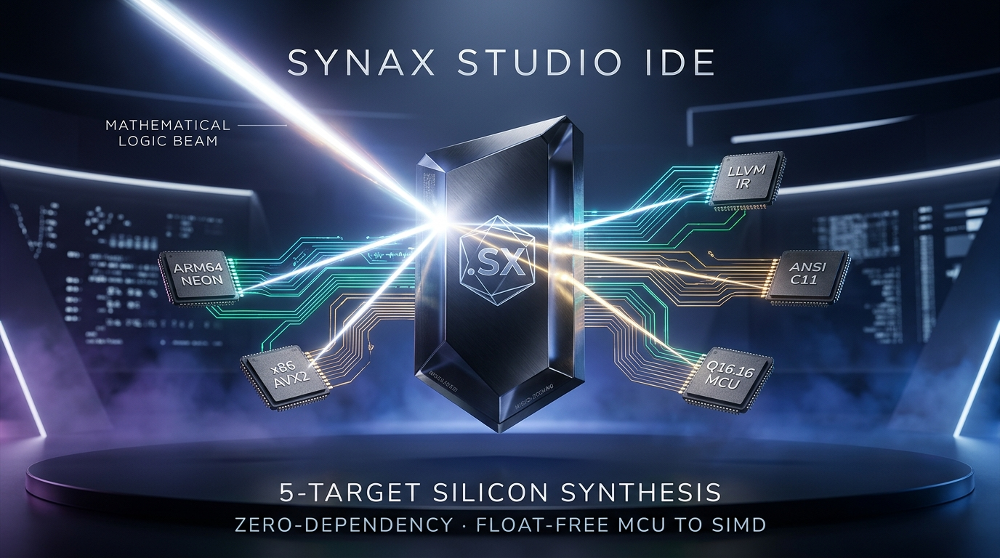

  

# 🖥️ SYNAX Studio IDE (`synax-studio`)

Standalone **Desktop Application (`SYNAX Studio.app`)** and **Web Workbench** for interactive `.sx` kernel compilation, E-Graph Equality Saturation inspection, Static IEEE-754 Interval Formal Verification, and Multi-Target Hardware Code Generation (**ARM64 NEON**, **x86_64 AVX2**, **LLVM IR**, **C11**, and **Q16.16 MCU**).
